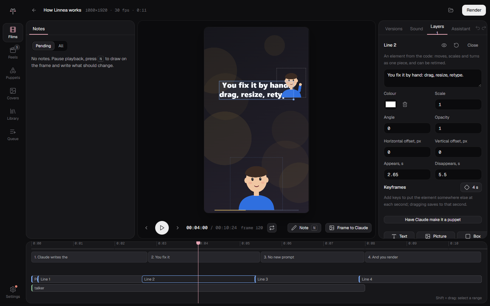
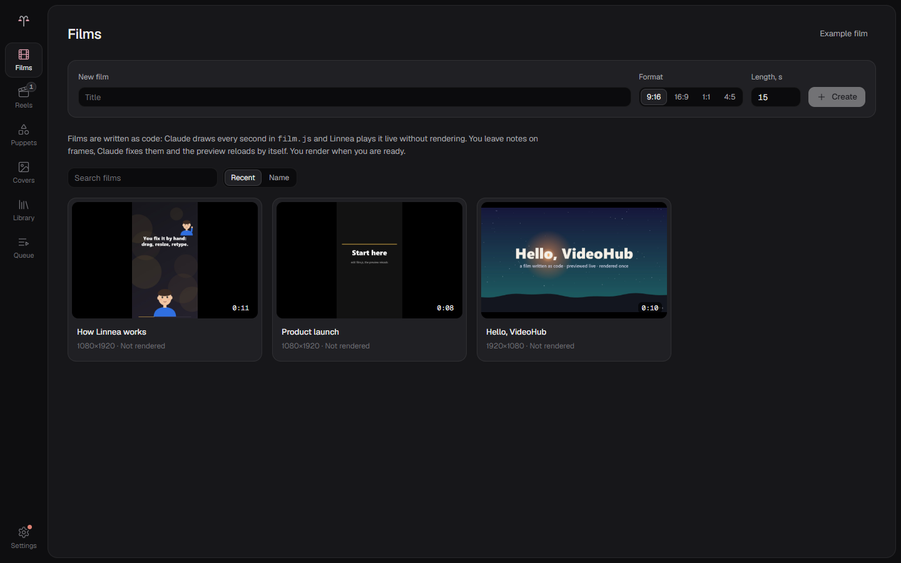
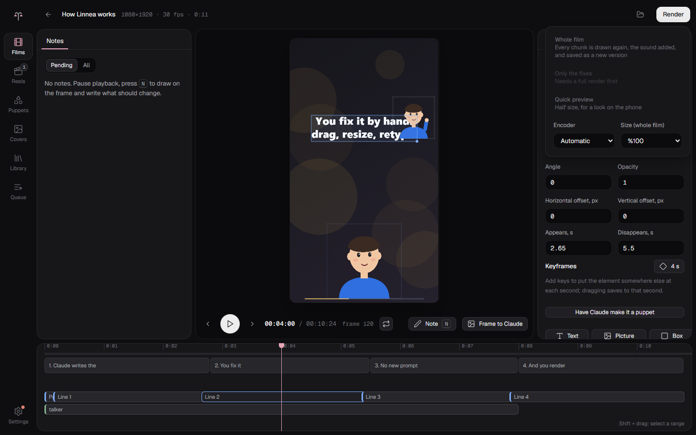
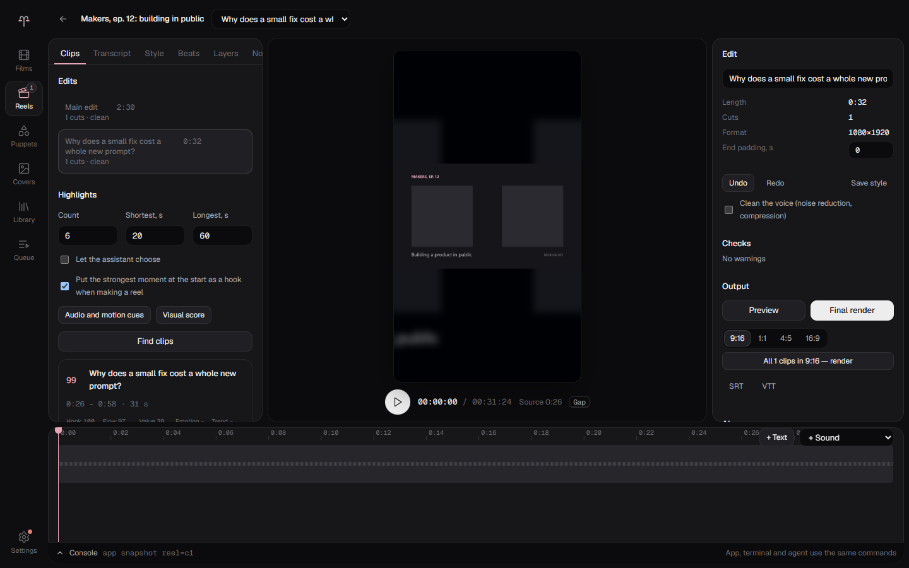
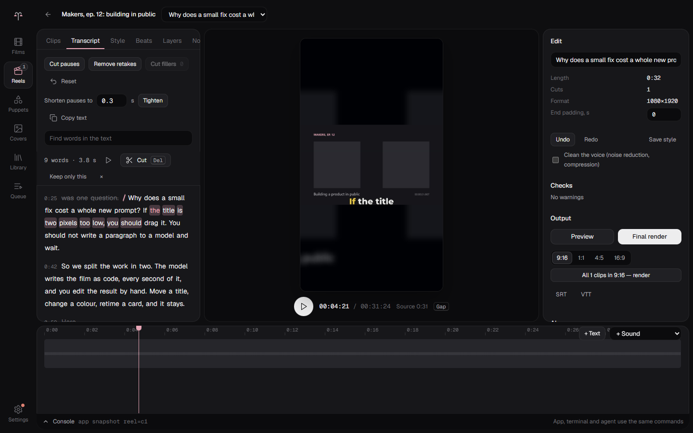
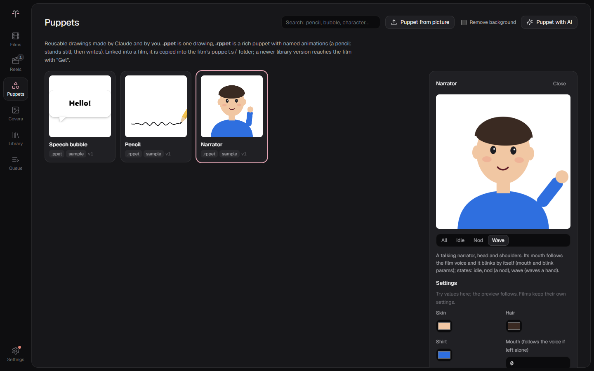
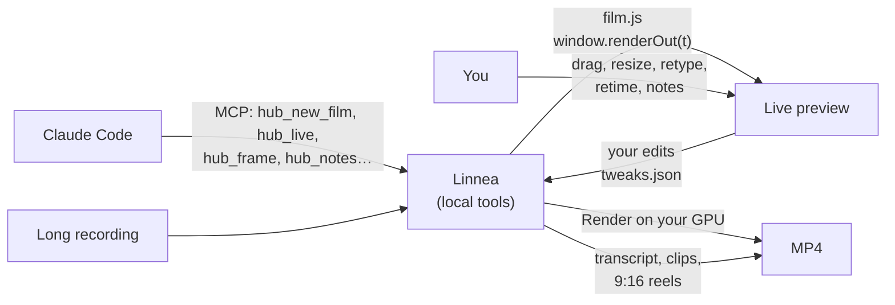

<div align="center">

# Linnea

**Claude writes the video. You finish it by hand.**

A local video suite for Windows, macOS and Linux: films written as code by Claude, edited with drag and
drop, rendered on your own machine, and long recordings cut into vertical clips.



</div>

---

## Why

Claude can already make a video: it writes the film as code, every second of it. The trouble starts after
the first draft. The title sits two pixels too low, a card shows up half a second late, a colour is wrong.
Each of those fixes means another prompt, another read of the code, another rewrite, and another round of
tokens, for a change you could have made with your mouse in a second.

**Linnea closes that gap.**

- **Edit by hand what Claude made.** Every title, card, character and object the film draws is a box you
  can click. Drag it, resize it, turn it, retype it, recolour it, retime it, keyframe it. No prompt, no tokens.
- **Your edits survive Claude's rewrites.** They live next to the code, not in it, so when Claude changes
  the film for you, your hand edits stay where you put them.
- **Prompt only for what needs a mind.** Leave a note on a frame, draw a circle on it, and Claude reads the
  close-up. Small fixes stay with you; real changes go to Claude.
- **You render.** Rendering runs on your computer, with your GPU. When only a few seconds changed, only
  those seconds are drawn again.
- **And it is a full video suite.** Drop in an hour-long recording and Linnea finds the moments that stand
  on their own, turns them into 9:16 reels, and lets you cut them by editing the transcript.

| A change like this | With prompts alone | In Linnea |
|---|---|---|
| Move a title, make it bigger | A prompt, a read of `film.js`, a rewrite, a check | Drag it. Zero tokens |
| Fix a typo on screen | The same round trip | Double-click and type |
| A card should appear at 2.5 s, not 2 s | The same round trip | Drag its bar on the timeline |
| Make the final video | Ask the agent to render, wait | Press **Render**; only changed chunks redraw |
| "This frame looks off" | Describe it in words | Draw on the frame; Claude sees the close-up |

---

## What it does

### Films written as code, edited like a design tool



Claude writes a film as a web page whose `renderOut(t)` draws second `t`. Linnea plays it live, straight
from the code, with no render in between, and reloads the preview the moment Claude saves a change.

- Click any element on the frame to select it: move, scale, rotate, fade, hide, retime, keyframe.
- Add your own layers on top: text, pictures, counters, handwriting, arrows, a phone, lower thirds,
  progress bars and puppets. Give any of them a motion path or rig it to a parent.
- Undo and redo across everything, with `Ctrl+Z` / `Ctrl+Y`.
- **Film assistant**: ask in plain words and the assistant edits `film.js`, checks the page, looks at the
  frames it changed and shows every step. Each request can be shown as a diff and taken back.
- **Notes on frames**: press `N`, draw on the frame, write what is wrong. "Fix with assistant" works
  through all open notes; "Check the fixes" shows each one before and after.

### Render on your own machine



- **Whole film**, **only the fixes** (just the 2-second chunks your fixed notes touched) or a **quick
  preview** at half size.
- NVIDIA, AMD and Intel hardware encoders, or x264 on the CPU.
- Every version is kept, and you can watch only what changed between two of them.

### One film, many languages

- Add a language and the film's on-screen texts are listed by element. Translate them yourself, let the
  built-in assistant do it, or hand it to Claude; the frame shows the language as you type.
- **Check layout** draws the film in that language and points at every text that now runs off the frame or
  got much wider, with the second it happens.
- Each language can have its own sound and renders as its own file (`film_de_v3.mp4`).
- Puppets a film made for itself are saved to the puppet library, so the next film can use them.

### Long videos into clips



- Import a file or a link (YouTube and anything yt-dlp reads). Linnea transcribes it locally with
  whisper.cpp, with word timings.
- **Find clips**: every moment is scored for a hook in its first line, a clean ending and pace; an
  assistant can pick instead, and audio energy and visual cues can join the score.
- **Play** a candidate before you commit, then **Make reel**: pauses trimmed, the speaker's face tracked
  into a 9:16 frame, captions placed word by word, the strongest line copied to the front as a hook.
- Batch-render every clip in 9:16, 1:1, 4:5 or 16:9.

### Cut by editing the text



- Drag across words to select them, press `Del`: they are gone from the video, at once.
- `P` plays the selection. `Ctrl+Z` undoes.
- Search the transcript and cut every match. Cut "um" and "uh" in one click.
- Pauses show up as small chips between words: click one to cut it, or shorten every pause to a length
  you choose.
- Remove retakes, keeping the later, fluent attempt of each sentence.

### Puppets: reusable, animated drawings



- A library of drawings with parameters (colours, text) and named animations (idle, wave, write…).
- **Talking characters**: give a puppet a mouth and it moves with the film's voice and blinks on its own.
- **Puppet with AI**: describe one in words; the assistant draws it, tries it in a browser, looks at its
  own picture, fixes it and saves it.
- Turn any picture into a puppet, with its background removed by a local model.
- States blend smoothly into each other; linked films pick up library updates.

### And more

- Styles, recipe packs and caption templates for reels; beats (big numbers, quotes, lists, memes, B-roll,
  kinetic text); sound effects levelled against the voice by role.
- Translation and dubbing (ElevenLabs, OpenAI, or Piper fully offline), automatic B-roll from Pexels,
  Pixabay or image models, eye-contact correction, speed ramps.
- Publish to YouTube, TikTok and Instagram from the app.
- Thumbnail studio: lay out a cover from a template, hand the brief to Claude, pick a variant.
- Storyboard strip under the preview (`B`), keyboard shortcuts for everything (`?`), and updates from
  GitHub from inside the app (Settings → Updates; on Windows it installs and restarts by itself).
- Delete (to the Recycle Bin), rename, duplicate, star, search and sort everything.
- English and Turkish interface (in Turkish the app is called **Linnea Kesit**).

---

## How it works



The app, the terminal (`linnea <tool> key=value`) and agents (over MCP) drive the same set of tools, so
whatever Claude does shows up in the open window, and whatever you do by hand is there for Claude to read.
Everything runs on your computer. Nothing is sent anywhere unless you choose an API service for a task.

---

## Install

Download the latest version from the [Releases](https://github.com/emircesur/Linnea/releases) page.

| System | Download | |
|---|---|---|
| **Windows 10 / 11** | `Linnea-Setup.exe` | Asks for your language, needs no administrator rights, and can connect itself to Claude Code. |
| **macOS** (Apple silicon) | `Linnea-…-macos-arm64.dmg` | Drag Linnea to Applications. Not notarized yet: the first time, right-click it and choose **Open**. |
| **macOS** (Intel) | `Linnea-…-macos-x64.dmg` | The same. |
| **Linux** (x86-64) | `Linnea-…-linux-x64.tar.gz` | Unpack it and run `./install.sh`. Needs WebKitGTK 4.1 (`libwebkit2gtk-4.1-0`). |

Windows is the main platform. On first start there, open **Settings → Tools → Download missing**: it
fetches ffmpeg, yt-dlp, whisper.cpp and its model (about 2.5 GB). On macOS and Linux, install those tools
with your package manager instead (for example `brew install ffmpeg yt-dlp whisper-cpp`); Linnea finds
them on your `PATH`.

### Connect Claude Code

```bash
claude mcp add linnea -- "%LOCALAPPDATA%\Programs\Linnea\bin\linnea.exe" mcp
```

On macOS the command is inside the app: `/Applications/Linnea.app/Contents/MacOS/linnea`. On Linux,
`install.sh` offers to connect it for you.

Copy `skill/linnea` to `~/.claude/skills/linnea` so Claude knows the workflow. Then ask Claude Code to
"make a film in Linnea" and watch it appear.

For the built-in assistants (film assistant, puppet maker, translation), pick a model under
**Settings → Assistant**: Claude, OpenAI, or a local server such as Ollama or LM Studio.

---

## Build from source

Requirements: Rust (stable), Node.js 18 or newer with pnpm, Python 3, and Microsoft Edge or Chrome.

```bash
cd ui && pnpm install && pnpm build && cd ..
cargo build --release -p linnea-cli -p linnea-app
```

```bash
python pack.py
```

On macOS and Linux, `bash packaging/macos.sh` and `bash packaging/linux.sh` turn the same release build
into `Linnea.app` with a disk image, or a `.tar.gz` (Linux also needs `libgtk-3-dev`, `libwebkit2gtk-4.1-dev`
and `libxdo-dev` to build). Pushing a tag such as `v0.2.0` makes GitHub Actions build all three and publish
them as a release (`.github/workflows/release.yml`).

`pack.py` builds the Windows release binaries, packs them with the library and the interface, and writes the
installer to `dist/Linnea-Setup.exe`. If the folder is deep, set `CARGO_TARGET_DIR` to a short path to stay
under Windows' 260-character limit.

| Run | Command |
|---|---|
| The app | `target/release/linnea-app.exe` |
| Check the machine | `linnea doctor` |
| List the tools | `linnea tools` |
| Server only (browser at http://127.0.0.1:7790) | `linnea serve` |
| MCP server | `linnea mcp` |

### Layout

```
crates/core    the engine: import, transcription, analysis, styles, captions, films, puppets, render,
               jobs, the tool registry, MCP and the local server
crates/cli     linnea: the terminal and the MCP server
crates/app     the window (wry) around the same server
crates/setup   the installer
ui             the interface (Vite + React + TypeScript)
library        styles, recipes, sounds, fonts, puppets, film templates
skill/linnea   the skill that teaches agents the workflow
```

Settings live in `%APPDATA%\Linnea\config.json`, tools and models in `%LOCALAPPDATA%\Linnea`, and your work in
`Videos\Linnea`. The command and the MCP server are both called `linnea`.

Coming from a version that was still called Kesit? Run the new installer: it removes the old program
files, the `kesit` command and the `kesit` MCP entry, and moves your settings to the new folders. Your work
stays where it is (`Videos\Kesit` keeps working), and old projects and films open as before.
 LINNEA : A Swedish given name derived from the 18th-century Swedish scientist Carl Linnaeus (Carl von Linné) or the twinflower (Linnaea borealis), which was named in his honor.
---

## Credits and license

Linnea is MIT licensed.

The editing rules, style presets, recipe packs, the `reel.json` format and the CC0 sound pack come from
[ghost-editor](https://github.com/kurbaitaev/ghost-editor) (MIT, kurbaitaev); the originals are in
`library/upstream`, `library/recipes` and `library/references`. The tool registry, the terminal/MCP parity
and the review-note loop follow [VideoHub](https://github.com/TensaikunYT/Videohub) (MIT). The fonts are
under the SIL Open Font License.
